# UA1 — Whole-app UI audit (iPhone + Mac)

Script: `python3 tests/ui_audit.py [--tag before|after] [--index <index.html>] [--vp 390,1280,1440] [--json f]` — Playwright on the mock-Firebase fixtures, stress data (SET: + 10-char tickers, 8 Core cards, 6 HOT sectors with 40–55 char names, long event titles, Thai notes, Sat plans in every error state, 12,345.67 numbers). 8 rules on every visible element; crops with red outline in `tests/screenshots/ua1/before|after/`.

## Before → after (findings, deduped per element)

| rule | 390 before→after | 1280 before→after | 1440 before→after |
|---|---|---|---|
| 1 word broken mid-word | 0 → 0 | 0 → 0 | 0 → 0 |
| 2 chip/pill/button wraps | 0 → 0 | 0 → 0 | 0 → 0 |
| 3 horizontal overflow / clipped | 4 → 0 | 2 → 0 | 0 → 0 |
| 4 lone control row | 5 → 5 | 8 → 8 | 8 → 8 |
| 5 duplicate message | 6 → 3 | 7 → 4 | 7 → 4 |
| 6 font / tap target too small | 601 → 90 | 322 → 4 | 322 → 4 |
| 7 overlap | 0 → 0 | 0 → 0 | 0 → 0 |
| 8 empty gap > 32px | 0 → 0 | 0 → 0 | 0 → 0 |
| **total** | 616 → 98 | 339 → 16 | 337 → 16 |

`before` = origin/main index (LN4c), `after` = this branch, same checker. Rules 1, 2, 7, 8 were 0 on this data once checker false positives were removed (inline-text rect overlaps, checkbox-in-label wraps, Thai mid-word, sticky/fixed bars, ellipsised text, scrolled modal rects).

## Fixed (pure layout/CSS — functions unchanged)
- **Rule 3**: Sat form status row (`▲ Up · Macro ▲ ● 0.20% $402 · Sat · Normal · Set default risk…`) was clipped (`overflow:hidden; nowrap`) at 390 and 1280 — chip and hint cut off the card edge. Now wraps (≥361px; 300/320 keep the old one-line shrink, suite 98 pins it).
- **Rule 5**: Sat form showed `R:R 2.0 ✓` twice (bar pill + chip row). Removed the chip-row copy; the bar pill is the single carrier (value and "TP wrong side"). Suite 369 expectation updated.
- **Rule 6**: font floors (iPhone: small/labels/hints 13, chips 13, caps 11; Mac ≥ 12.5) for ~60 classes, and 36px min tap height for buttons/summary/select on phone (zero-specificity `:where`, so existing larger min-heights win; `✓ all` and the privacy eye excluded). Verified no element got smaller (computed-font diff of 2,854 text elements old vs new = 0 decreases).
- Tests adjusted for deliberate changes: 369 (no rr chip), 371 (HOT font 13 not 11.5; one-line check by text height not box height), 104 (Mac `opLab` 12→12.5).

## Related suites vs origin/main (fail counts)
369: 0 · 370: 0 · 372: 0 · HT1: 0 · 371: 2 (= main, HOT rule from HT1) · 104: 13 (= main) · 98: 37 (= main) · 108: 8 / 82: 1 / 90: 4 / 92: 5 (= main). No new failures; the pre-existing ones are old-layout assertions not touched here.

## Needs SRTp decision (not changed)
1. **Today iPhone status/HOT/TODAY card (LN4c compact design)** — remaining 90 iPhone rule-6 findings are mostly here: room/label 12px, `2/7` badge 12px, HOT chips and `+5` 26px high, `Calendar ›` link 15px, event lines 28px high, `homework · 2 stocks` 30px, Details summary 31px, `NEW` 9.5px. Raising them to 13px/36px would re-inflate the card you just shrank. Crops: `tests/screenshots/ua1/after/today-daily-390-r6-*.png`.
2. **Bottom tab bar** labels are 11.2px (chip rule says 13) and 32–34px tall (< 36). Fitting 6 tabs at 13px needs shorter labels or icons.
3. **Tiny icon buttons**: `▾` (Flow themes, Journal column menus) 18–19px, `👁` privacy 20px, `Calendar ›`, `Clear Note`/`More` links 20px. Need a bigger hit area (padding) or dropping them.
4. **Lone control rows (rule 4, 21)**: `Not trading this week` (Sat tile), `＋ แผน Core` (Core empty state, Mac), `Add product` (Settings), `ไม่อยู่ใน Watchlist…` chip (Core card), Playbook sheet footers (`ปิด`, `ตรวจ`), a single `P1 · เสาหลัก 1` chip. Merge into the row above / full-width / remove is a design call.
5. **Duplicates left (rule 5)**: (a) Sat form `Set default risk in Settings` in the status row AND the account row below (when an account has no default risk); (b) TP wrong side: bar pill `R:R — · TP wrong side` + hint `ใส่ TP ให้ R:R ≥ 1.5 ก่อน…` (different wording, same fact); (c) `＋ แผน Core` button twice on the empty Core list (Mac).
6. The **Mac regime label vs MMT/COMP chip** duplicate did not trigger on this fixture (no regime label rendered next to the chip); not confirmed fixed — needs a fixture where both show.

## Coverage / limits
Visited (all three viewports, see table): Today Daily / Weekend / news-row click, Flow, Watch Ideas/Candidates/Watchlist, Core list + new form (+ error state) + open card, Sat list, Sat form × 6 states × 2 assets, Journal, Port, Settings, TradingView import, Idea import/new, Playbook history/paste/asset sheets. Not covered: Core form COMP-track toggle variants, Sat forms with 3+ accounts, idea detail sheets (`ideaOpen`), `ltImportOpen`/`sdImportOpen`, anything needing real data. Rule 8 skips scrolled modals (rects not comparable). Rule 6 tap-size is checked on iPhone only.

Generated by `python3 tests/ui_audit.py`. Viewports 390×844 · 1280×800 · 1440×900; fixtures + stress data.

## Screens visited

| screen | 390 | 1280 | 1440 |
|---|---|---|---|
| Today · Daily | ok | ok | ok |
| Today · Weekend | ok | ok | ok |
| Today · Daily (news row clicked) | ok | ok | ok |
| Flow | ok | ok | ok |
| Watch · Ideas | ok | ok | ok |
| Watch · Candidates | ok | ok | ok |
| Watch · Watchlist | ok | ok | ok |
| Plan · Core list | ok | ok | ok |
| Plan · Core new form | ok | ok | ok |
| Plan · Sat list | ok | ok | ok |
| Journal | ok | ok | ok |
| Port | ok | ok | ok |
| Settings | ok | ok | ok |
| TradingView import sheet | ok | ok | ok |
| Idea import sheet | ok | ok | ok |
| Idea new sheet | ok | ok | ok |
| Playbook history | ok | ok | ok |
| Playbook paste | ok | ok | ok |
| Playbook asset sheet | ok | ok | ok |
| Plan · Core new form (error: stop = entry) | ok | ok | ok |
| Plan · Sat form · valid long (XAUUSD) | ok | ok | ok |
| Plan · Sat form · SL wrong side (XAUUSD) | ok | ok | ok |
| Plan · Sat form · TP wrong side (XAUUSD) | ok | ok | ok |
| Plan · Sat form · short valid (XAUUSD) | ok | ok | ok |
| Plan · Sat form · empty fields (XAUUSD) | ok | ok | ok |
| Plan · Sat form · big numbers 12,345.67 (XAUUSD) | ok | ok | ok |
| Plan · Sat form · valid long (USDJPY) | ok | ok | ok |
| Plan · Sat form · SL wrong side (USDJPY) | ok | ok | ok |
| Plan · Sat form · TP wrong side (USDJPY) | ok | ok | ok |
| Plan · Sat form · short valid (USDJPY) | ok | ok | ok |
| Plan · Sat form · empty fields (USDJPY) | ok | ok | ok |
| Plan · Sat form · big numbers 12,345.67 (USDJPY) | ok | ok | ok |
| Plan · Core open card | ok | ok | ok |

## Counts per rule

| rule | 390 | 1280 | 1440 | total |
|---|---|---|---|---|
| 1 word broken mid-word | 0 | 0 | 0 | 0 |
| 2 chip/pill/button wraps | 0 | 0 | 0 | 0 |
| 3 horizontal overflow / clipped | 0 | 0 | 0 | 0 |
| 4 lone control row | 5 | 8 | 8 | 21 |
| 5 duplicate message | 3 | 4 | 4 | 11 |
| 6 font / tap target too small | 90 | 4 | 4 | 98 |
| 7 overlap | 0 | 0 | 0 | 0 |
| 8 empty gap > 32px | 0 | 0 | 0 | 0 |

## Findings

| # | screen | vp | rule | element | text | note | crop |
|---|---|---|---|---|---|---|---|
| 1 | Plan · Core list | 1280 | 4 | `div#lfCoreSide > div.card.lf-sidehint > div.lf-nf-row > button.chip` | ＋ แผน Core | only control in a row; row 547px wide, control 97px (82% empty) (+1 more screens) |  |
| 2 | Plan · Core list | 1440 | 4 | `div#lfCoreSide > div.card.lf-sidehint > div.lf-nf-row > button.chip` | ＋ แผน Core | only control in a row; row 562px wide, control 97px (83% empty) (+1 more screens) |  |
| 3 | Plan · Core open card | 1280 | 4 | `div.ccCard.open > div.ccBody > div.ccFull.ccChips > span.ccChip.warn` | ไม่อยู่ใน Watchlist · ยังไม่ได้ทำการบ้าน | only control in a row; row 593px wide, control 222px (63% empty) | 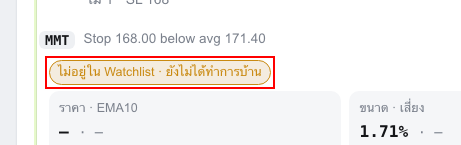 |
| 4 | Plan · Core open card | 1440 | 4 | `div.ccCard.open > div.ccBody > div.ccFull.ccChips > span.ccChip.warn` | ไม่อยู่ใน Watchlist · ยังไม่ได้ทำการบ้าน | only control in a row; row 610px wide, control 222px (64% empty) | 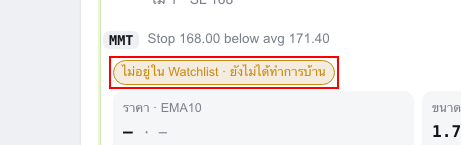 |
| 5 | Plan · Sat list | 390 | 4 | `div.ln1-tiles > div.ui-tile.ln1-tile > div.td3-ntrow > button.td3-lk` | Not trading this week | only control in a row; row 282px wide, control 139px (51% empty) (+12 more screens) | 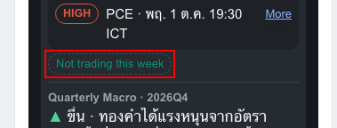 |
| 6 | Plan · Sat list | 1280 | 4 | `div.ln1-tiles > div.ui-tile.ln1-tile > div.td3-ntrow > button.td3-lk` | Not trading this week | only control in a row; row 276px wide, control 125px (55% empty) (+38 more screens) |  |
| 7 | Plan · Sat list | 1440 | 4 | `div.ln1-tiles > div.ui-tile.ln1-tile > div.td3-ntrow > button.td3-lk` | Not trading this week | only control in a row; row 284px wide, control 125px (56% empty) (+38 more screens) | 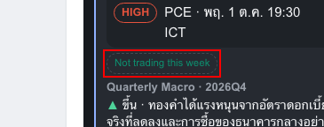 |
| 8 | Playbook asset sheet | 390 | 4 | `div.ui-sheet > div.pbSh > div.ui-chips > span.ui-chip` | P1 · เสาหลัก 1 | only control in a row; row 358px wide, control 91px (75% empty) | 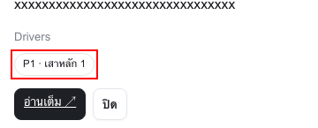 |
| 9 | Playbook asset sheet | 1280 | 4 | `div.ui-sheet > div.pbSh > div.ui-chips > span.ui-chip` | P1 · เสาหลัก 1 | only control in a row; row 688px wide, control 97px (86% empty) | 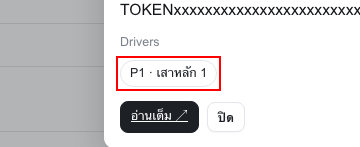 |
| 10 | Playbook asset sheet | 1440 | 4 | `div.ui-sheet > div.pbSh > div.ui-chips > span.ui-chip` | P1 · เสาหลัก 1 | only control in a row; row 688px wide, control 97px (86% empty) | 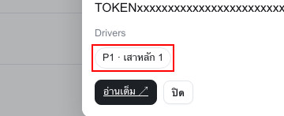 |
| 11 | Playbook history | 390 | 4 | `div.ui-sheet > div.pbSh > div.pbBtns > button.ui-btn` | ปิด | only control in a row; row 358px wide, control 39px (89% empty) | 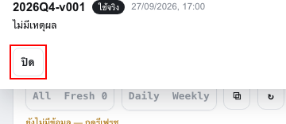 |
| 12 | Playbook history | 1280 | 4 | `div.ui-sheet > div.pbSh > div.pbBtns > button.ui-btn` | ปิด | only control in a row; row 688px wide, control 38px (94% empty) | 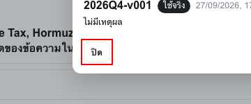 |
| 13 | Playbook history | 1440 | 4 | `div.ui-sheet > div.pbSh > div.pbBtns > button.ui-btn` | ปิด | only control in a row; row 688px wide, control 38px (94% empty) | 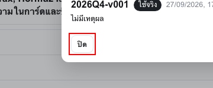 |
| 14 | Playbook paste | 390 | 4 | `div#pbPasteHost > div.pbSh > div.pbBtns > button.ui-btn.ui-btn-pri` | ตรวจ | only control in a row; row 358px wide, control 50px (86% empty) | 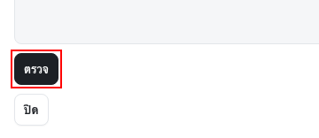 |
| 15 | Playbook paste | 390 | 4 | `div#pbPasteHost > div.pbSh > div.pbBtns > button.ui-btn` | ปิด | only control in a row; row 358px wide, control 39px (89% empty) | 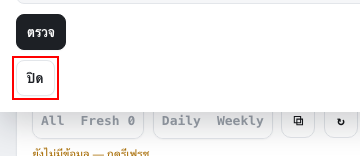 |
| 16 | Playbook paste | 1280 | 4 | `div#pbPasteHost > div.pbSh > div.pbBtns > button.ui-btn.ui-btn-pri` | ตรวจ | only control in a row; row 688px wide, control 49px (93% empty) | 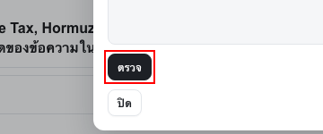 |
| 17 | Playbook paste | 1280 | 4 | `div#pbPasteHost > div.pbSh > div.pbBtns > button.ui-btn` | ปิด | only control in a row; row 688px wide, control 38px (94% empty) | 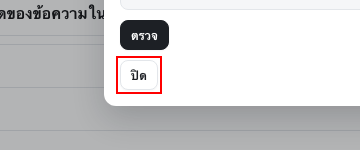 |
| 18 | Playbook paste | 1440 | 4 | `div#pbPasteHost > div.pbSh > div.pbBtns > button.ui-btn.ui-btn-pri` | ตรวจ | only control in a row; row 688px wide, control 49px (93% empty) | 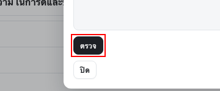 |
| 19 | Playbook paste | 1440 | 4 | `div#pbPasteHost > div.pbSh > div.pbBtns > button.ui-btn` | ปิด | only control in a row; row 688px wide, control 38px (94% empty) | 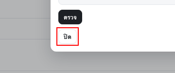 |
| 20 | Settings | 1280 | 4 | `button#set1PnAdd` | Add product | only control in a row; row 496px wide, control 100px (80% empty) |  |
| 21 | Settings | 1440 | 4 | `button#set1PnAdd` | Add product | only control in a row; row 496px wide, control 100px (80% empty) |  |
| 22 | Plan · Core list | 1280 | 5 | `div#lfCoreSide > div.card.lf-sidehint > div.lf-nf-row > button.chip` | ＋ แผน Core | same text shown 2× in one card: "＋ แผน core" (+1 more screens) |  |
| 23 | Plan · Core list | 1440 | 5 | `div#lfCoreSide > div.card.lf-sidehint > div.lf-nf-row > button.chip` | ＋ แผน Core | same text shown 2× in one card: "＋ แผน core" (+1 more screens) | 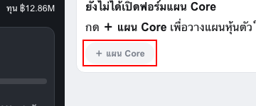 |
| 24 | Plan · Sat form · TP wrong side (XAUUSD) | 390 | 5 | `div.ui-pgrid > div.ui-pcell > div.ui-plan.ln1-card > div.pf-hint` | ใส่ TP ให้ R:R ≥ 1.5 ก่อน — บันทึกเป็นร่ | R:R shown 2× in one card: "R:R — · TP wrong side" / "ใส่ TP ให้ R:R ≥ 1.5 ก่อน — บั" (+7 more screens) |  |
| 25 | Plan · Sat form · TP wrong side (XAUUSD) | 1280 | 5 | `div.ui-pgrid > div.ui-pcell > div.ui-plan.ln1-card > div.pf-hint` | ใส่ TP ให้ R:R ≥ 1.5 ก่อน — บันทึกเป็นร่ | R:R shown 2× in one card: "R:R — · TP wrong side" / "ใส่ TP ให้ R:R ≥ 1.5 ก่อน — บั" (+7 more screens) |  |
| 26 | Plan · Sat form · TP wrong side (XAUUSD) | 1440 | 5 | `div.ui-pgrid > div.ui-pcell > div.ui-plan.ln1-card > div.pf-hint` | ใส่ TP ให้ R:R ≥ 1.5 ก่อน — บันทึกเป็นร่ | R:R shown 2× in one card: "R:R — · TP wrong side" / "ใส่ TP ให้ R:R ≥ 1.5 ก่อน — บั" (+7 more screens) | 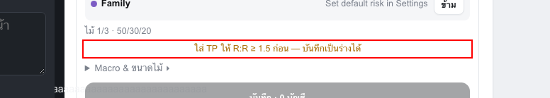 |
| 27 | Plan · Sat form · big numbers 12,345.67 (XAUUSD) | 390 | 5 | `div.ui-pgrid > div.ui-pcell > div.ui-plan.ln1-card > div.pf-hint` | ใส่ TP ให้ R:R ≥ 1.5 ก่อน — บันทึกเป็นร่ | R:R shown 2× in one card: "R:R 1.2" / "ใส่ TP ให้ R:R ≥ 1.5 ก่อน — บั" (+3 more screens) | 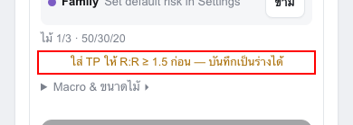 |
| 28 | Plan · Sat form · big numbers 12,345.67 (XAUUSD) | 1280 | 5 | `div.ui-pgrid > div.ui-pcell > div.ui-plan.ln1-card > div.pf-hint` | ใส่ TP ให้ R:R ≥ 1.5 ก่อน — บันทึกเป็นร่ | R:R shown 2× in one card: "R:R 1.2" / "ใส่ TP ให้ R:R ≥ 1.5 ก่อน — บั" (+3 more screens) | 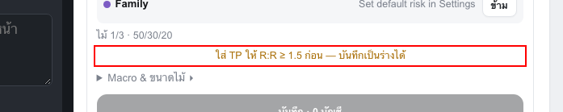 |
| 29 | Plan · Sat form · big numbers 12,345.67 (XAUUSD) | 1440 | 5 | `div.ui-pgrid > div.ui-pcell > div.ui-plan.ln1-card > div.pf-hint` | ใส่ TP ให้ R:R ≥ 1.5 ก่อน — บันทึกเป็นร่ | R:R shown 2× in one card: "R:R 1.2" / "ใส่ TP ให้ R:R ≥ 1.5 ก่อน — บั" (+3 more screens) |  |
| 30 | Plan · Sat form · valid long (XAUUSD) | 390 | 5 | `div.ln1-szs > div.ln1-sz > span.ln1-sv > span.ui-hint` | Set default risk in Settings | same text shown 2× in one card: "set default risk in settings" (+5 more screens) | 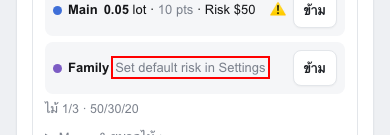 |
| 31 | Plan · Sat form · valid long (XAUUSD) | 1280 | 5 | `div.ln1-szs > div.ln1-sz > span.ln1-sv > span.ui-hint` | Set default risk in Settings | same text shown 2× in one card: "set default risk in settings" (+5 more screens) | 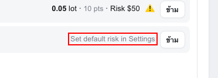 |
| 32 | Plan · Sat form · valid long (XAUUSD) | 1440 | 5 | `div.ln1-szs > div.ln1-sz > span.ln1-sv > span.ui-hint` | Set default risk in Settings | same text shown 2× in one card: "set default risk in settings" (+5 more screens) | 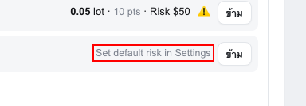 |
| 33 | Flow | 390 | 6 | `details.panel.pbPanel > div.pbCard > div.pbHead > span.pbCaret` | ▸ | small font 12px < 13 | 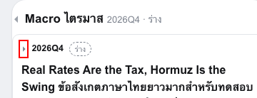 |
| 34 | Flow | 390 | 6 | `details.panel.pbPanel > div.pbCard > div.pbHead > b.pbQ` | 2026Q4 | small font 12.5px < 13 | 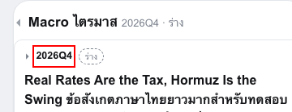 |
| 35 | Flow | 390 | 6 | `details.panel.pbPanel > div.pbCard > div.pbHead > span.pbBadge.dr` | ร่าง | chip font 10.5px < 13 |  |
| 36 | Flow | 390 | 6 | `div#ffThemesHead > div > div.ffLbl` | แผนที่ธีม · RELATIVE TREND VS SPY อัตโนม | caps label font 10.88px < 11 |  |
| 37 | Flow | 390 | 6 | `button#ffThemesBtn` | ▾ | tap target height 18px < 36 |  |
| 38 | Flow | 390 | 6 | `div#ffRrgBar > div.rrgStatus > span.ffNote` | ยังไม่มีข้อมูล — กดรีเฟรช | small font 11.22px < 13 |  |
| 39 | Flow | 390 | 6 | `span#ffLogLine` | ยังไม่มีการแก้บอร์ด | small font 11.22px < 13 |  |
| 40 | Journal | 390 | 6 | `button#jColBtn_closed` | ▾ | chip font 12.75px < 13 |  |
| 41 | Journal | 390 | 6 | `div#jFilters > div.hint > span.ln4-wk > span.ln4-stg` | Stage 1 · ¼ | small font 12px < 13 |  |
| 42 | Journal | 390 | 6 | `button#jColBtn_setup` | ▾ | chip font 12.75px < 13 |  |
| 43 | Journal | 390 | 6 | `button#jColBtn_setup` | ▾ | tap target height 18px < 36 |  |
| 44 | Journal | 390 | 6 | `button#jColBtn_cond` | ▾ | chip font 12.75px < 13 |  |
| 45 | Journal | 390 | 6 | `button#jColBtn_cond` | ▾ | tap target height 18px < 36 |  |
| 46 | Plan · Core list | 390 | 6 | `div.lf-rows > div.lfa > div.ln2-s.s2 > span` | Legacy Momentum DD 0% Legacy Compounder  | body font 13px < 14 (+3 more screens) |  |
| 47 | Plan · Core list | 390 | 6 | `div.ln2-box.lf-multi > div.lf-rows > div.lfa > div.ln2-al` | ⚠ ขาดราคา 1 ตัว (SET:ADVANC) — ไม่นับใน  | body font 13px < 14 (+1 more screens) |  |
| 48 | Plan · Core list | 390 | 6 | `div.ccList > div.ccCard > button.ccRow.lfRow > span.ccIc.nt` | 📝 | small font 11.9px < 13 (+5 more screens) |  |
| 49 | Plan · Core new form | 390 | 6 | `span#cnE0x > label.ps1Pc > i` | % | small font 12.58px < 13 (+1 more screens) |  |
| 50 | Plan · Core new form | 390 | 6 | `div#cnEx > div.ps1R > label.ps1Pc > i` | % | small font 12.58px < 13 (+1 more screens) |  |
| 51 | Plan · Core new form | 390 | 6 | `button#cnEplus` | ＋ Entry | chip font 12.58px < 13 (+1 more screens) |  |
| 52 | Plan · Core new form | 390 | 6 | `button#cnSplus` | ＋ SL | chip font 12.58px < 13 (+1 more screens) |  |
| 53 | Plan · Core new form | 390 | 6 | `div#cnSum > div.ps1Plan` | Planned total: #64 · 5.8% · Risk ฿32.0k  | body font 13.94px < 14 |  |
| 54 | Plan · Core new form | 390 | 6 | `div#cnPortLn > span` | 2.9% of MMT · cap 7.5% (15% of MMT) | small font 11.5px < 13 |  |
| 55 | Plan · Core new form | 390 | 6 | `div#cnPortLn > a` | Details › | small font 11.5px < 13 |  |
| 56 | Plan · Core new form | 390 | 6 | `div#cnFt` | Fast-track — homework due in 3 days (the | body font 13.6px < 14 (+1 more screens) |  |
| 57 | Plan · Core open card | 390 | 6 | `div.ccCard.open > div.ccBody > div.ccFull.ccChips > span.ccChip.warn` | ไม่อยู่ใน Watchlist · ยังไม่ได้ทำการบ้าน | chip font 12.24px < 13 |  |
| 58 | Plan · Sat form · TP wrong side (XAUUSD) | 390 | 6 | `div.ui-pgrid > div.ui-pcell > div.ui-plan.ln1-card > div.pf-hint` | ใส่ TP ให้ R:R ≥ 1.5 ก่อน — บันทึกเป็นร่ | body font 12.5px < 14 (+5 more screens) |  |
| 59 | Plan · Sat form · valid long (USDJPY) | 390 | 6 | `label#pf-vl-i1790830835680` | Verify | small font 12px < 13 (+5 more screens) |  |
| 60 | Plan · Sat form · valid long (XAUUSD) | 390 | 6 | `div.ui-pcell > div.ui-plan.ln1-card > div.ui-plan-h > span.ui-tag` | Main | chip font 11px < 13 (+11 more screens) |  |
| 61 | Plan · Sat form · valid long (XAUUSD) | 390 | 6 | `v.ui-plan.ln1-card > div.ui-v2.ln1-form > div.ln3-st > span.ps1Chip.ok` | Sat · Normal | chip font 12px < 13 (+23 more screens) |  |
| 62 | Plan · Sat form · valid long (XAUUSD) | 390 | 6 | `div.pf-blk > div.pf-r1 > div.pf-tf > label` | TF | small font 12px < 13 (+11 more screens) |  |
| 63 | Plan · Sat form · valid long (XAUUSD) | 390 | 6 | `div.pf-blk > div.pf-r1 > div > label` | Trend | small font 12px < 13 (+11 more screens) |  |
| 64 | Plan · Sat form · valid long (XAUUSD) | 390 | 6 | `label#pf-vl-i1790830827194` | Verify | small font 12px < 13 (+5 more screens) |  |
| 65 | Plan · Sat form · valid long (XAUUSD) | 390 | 6 | `div.ui-v2.ln1-form > div.pf-blk > div.pf-r2 > label.pf-zl` | Zone | small font 12px < 13 (+11 more screens) |  |
| 66 | Plan · Sat form · valid long (XAUUSD) | 390 | 6 | `div.ui-v2.ln1-form > div.pf-blk > div.pf-chips > button.ln4-all` | ✓ all | chip font 11.22px < 13 (+11 more screens) |  |
| 67 | Plan · Sat form · valid long (XAUUSD) | 390 | 6 | `div.ln1-g3 > div > label > b.pf-req` | * | small font 12px < 13 (+11 more screens) |  |
| 68 | Plan · Sat form · valid long (XAUUSD) | 390 | 6 | `div.ui-pgrid > div.ui-pcell > div.ui-plan.ln1-card > div.ln3-leg` | ไม้ 1/3 · 50/30/20 | small font 12.5px < 13 (+11 more screens) |  |
| 69 | Plan · Sat form · valid long (XAUUSD) | 1280 | 6 | `div.ui-v2.ln1-form > div.pf-blk > div.pf-chips > button.ln4-all` | ✓ all | Mac min font 11.22px < 12.5 (+11 more screens) | 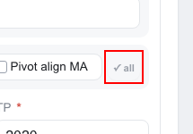 |
| 70 | Plan · Sat form · valid long (XAUUSD) | 1440 | 6 | `div.ui-v2.ln1-form > div.pf-blk > div.pf-chips > button.ln4-all` | ✓ all | Mac min font 11.22px < 12.5 (+11 more screens) | 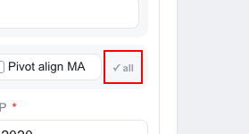 |
| 71 | Plan · Sat list | 390 | 6 | `span.wiChip.wi-HIGH > button.wiNm > span.wiLb2 > span.wiTx` | HIGH | small font 11.5px < 13 (+25 more screens) |  |
| 72 | Plan · Sat list | 390 | 6 | `span.wiChip.wi-MED > button.wiNm > span.wiLb2 > span.wiTx` | MED | small font 11.5px < 13 (+25 more screens) |  |
| 73 | Plan · Sat list | 390 | 6 | `div#satV3Sum > div.waBar.lf > span.waChip.lf-at > button.satPin` | ☆ | tap target height 32px < 36 (+38 more screens) |  |
| 74 | Plan · Sat list | 390 | 6 | `div#satV3Sum > div.waBar.lf > span.waChip.lf-at > button.waName` | XAUUSD | tap target height 30px < 36 (+12 more screens) |  |
| 75 | Plan · Sat list | 390 | 6 | `div#satV3Sum > div.waBar.lf > span.waChip.lf-at > button.waMore` | ⋯ | tap target height 30px < 36 (+38 more screens) |  |
| 76 | Plan · Sat list | 390 | 6 | `div#satV3Sum > div.waBar.lf > span.waChip.lf-at > button.waName` | BTC | tap target height 30px < 36 (+12 more screens) |  |
| 77 | Plan · Sat list | 390 | 6 | `div#satV3Sum > div.waBar.lf > span.waChip.lf-at > button.waName` | USDJPY | tap target height 30px < 36 (+12 more screens) |  |
| 78 | Plan · Sat list | 390 | 6 | `tile.ln1-tile > div.ui-tile-th.ln1-th > span.ui-tile-a > button.satPin` | ☆ | tap target height 32px < 36 (+12 more screens) |  |
| 79 | Plan · Sat list | 390 | 6 | `div.ui-tile.ln1-tile > div.wiStrip > div.wiS2 > span.wiTierP.wi-HIGH` | HIGH | small font 12.5px < 13 (+12 more screens) |  |
| 80 | Plan · Sat list | 390 | 6 | `div.ln1-tiles > div.ui-tile.ln1-tile > div.td3-ntrow > button.td3-lk` | Not trading this week | tap target height 24px < 36 (+12 more screens) |  |
| 81 | Plan · Sat list | 390 | 6 | `s > div.ui-tile.ln1-tile > div.ln3-zr.pf2-blk > button.ln1-link.pf2-rd` | อ่านต่อ | tap target height 32px < 36 (+12 more screens) |  |
| 82 | Plan · Sat list | 390 | 6 | ` > div.ui-tile.ln1-tile > div.ln3-chg.pf2-blk > button.ln1-link.pf2-rd` | อ่านต่อ | tap target height 32px < 36 (+12 more screens) |  |
| 83 | Plan · Sat list | 1280 | 6 | `span.wiChip.wi-HIGH > button.wiNm > span.wiLb2 > span.wiTx` | HIGH | Mac min font 11.5px < 12.5 (+25 more screens) | 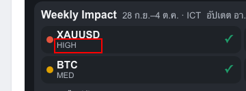 |
| 84 | Plan · Sat list | 1280 | 6 | `span.wiChip.wi-MED > button.wiNm > span.wiLb2 > span.wiTx` | MED | Mac min font 11.5px < 12.5 (+25 more screens) | 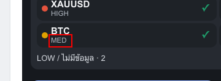 |
| 85 | Plan · Sat list | 1280 | 6 | `div.ln1-tiles > div.ui-tile.ln1-tile > div.td3-ntrow > button.td3-lk` | Not trading this week | Mac min font 11.5px < 12.5 (+38 more screens) | 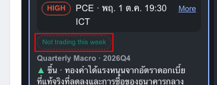 |
| 86 | Plan · Sat list | 1440 | 6 | `span.wiChip.wi-HIGH > button.wiNm > span.wiLb2 > span.wiTx` | HIGH | Mac min font 11.5px < 12.5 (+25 more screens) | 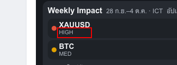 |
| 87 | Plan · Sat list | 1440 | 6 | `span.wiChip.wi-MED > button.wiNm > span.wiLb2 > span.wiTx` | MED | Mac min font 11.5px < 12.5 (+25 more screens) | 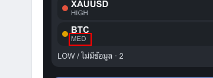 |
| 88 | Plan · Sat list | 1440 | 6 | `div.ln1-tiles > div.ui-tile.ln1-tile > div.td3-ntrow > button.td3-lk` | Not trading this week | Mac min font 11.5px < 12.5 (+38 more screens) |  |
| 89 | Playbook asset sheet | 390 | 6 | `div.ui-sheet > div.pbSh > div.ui-chips > span.ui-chip` | P1 · เสาหลัก 1 | chip font 11.5px < 13 |  |
| 90 | Playbook history | 390 | 6 | `div.pbSh > div.pbHist > div.pbHistT > span.pbBadge.on` | ใช้จริง | chip font 10.5px < 13 |  |
| 91 | Playbook history | 390 | 6 | `div.pbSh > div.pbHist > div.pbHistT > span.pbDate` | 27/09/2026, 17:00 | small font 11.5px < 13 |  |
| 92 | Playbook history | 390 | 6 | `div.ui-sheet > div.pbSh > div.pbHist > div.pbHistS` | ไม่มีเหตุผล | small font 12.5px < 13 |  |
| 93 | Port | 390 | 6 | `button#brandSync` | ซิงก์แล้ว — ข้ามอุปกรณ์ได้ | tap target height 15px < 36 (+1 more screens) |  |
| 94 | Port | 390 | 6 | `div.ln3-pg > div > div.v > button.privEye` | 👁 | tap target height 20px < 36 (+1 more screens) |  |
| 95 | Port | 390 | 6 | `div#mixBody > div.panel.ln3-pcard > div.it > span.ln4-pb.a` | stop below avg | small font 12px < 13 (+1 more screens) |  |
| 96 | Port | 390 | 6 | `div.ln3-pcard > details.poolLine > summary > span` | Momentum 0/50 · Compounder 0/30 · Sat 0/ | body font 13px < 14 (+1 more screens) |  |
| 97 | Port | 390 | 6 | `div.panel.ln3-pcard > div.ln3-ph > span > button.ddChip.dd-normal` | Momentum DD 0% · ปกติ | tap target height 29px < 36 (+3 more screens) |  |
| 98 | Port | 390 | 6 | `div.panel.ln3-pcard > div.ln3-ph > span > button.ddChip.dd-normal` | Compounder DD 0% · ปกติ | tap target height 29px < 36 (+3 more screens) |  |
| 99 | Port | 390 | 6 | `div.panel.ln3-pcard > div.ln3-ph > span > button.ddChip.dd-normal` | DD 0% · ปกติ | tap target height 29px < 36 (+3 more screens) |  |
| 100 | Settings | 390 | 6 | `div.secbody > div.f > label > span` | (cash reserve outside the 3 ports · incl | body font 13px < 14 |  |
| 101 | Settings | 390 | 6 | `div#poolBlock > label > span.crUnit` | % of account (Core ฿ + Sat $ · Strategic | body font 13px < 14 |  |
| 102 | Settings | 390 | 6 | `div#poolNotice` | The whole account (Core + Sat) was re-sp | body font 13.6px < 14 |  |
| 103 | Settings | 390 | 6 | `details#ps1Sec > div.secbody > div.ps1Row > span.ps1Rg` | distance from each entry to SL1 · empty  | body font 13px < 14 |  |
| 104 | Settings | 390 | 6 | `div.fgrid > div.f > label > span.crUnit` | % of the pool (Momentum · Compounder eac | body font 13px < 14 (+1 more screens) |  |
| 105 | Settings | 390 | 6 | `div.fgrid > div.f > label > span.crUnit` | % separated by / e.g. 60/40 · 100 = sing | body font 13px < 14 |  |
| 106 | Today · Daily | 390 | 6 | `button#brandSync` | ซิงก์แล้ว — ข้ามอุปกรณ์ได้ | tap target height 20px < 36 (+22 more screens) | 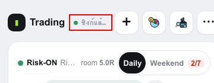 |
| 107 | Today · Daily | 390 | 6 | `span#brandSyncTime` | ซิงก์แล้ว — ข้ามอุปกรณ์ได้ | small font 11.56px < 13 (+22 more screens) | 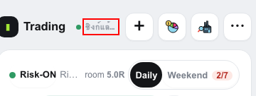 |
| 108 | Today · Daily | 390 | 6 | `button#tabBtnToday` | Today | chip font 11.22px < 13 (+24 more screens) | 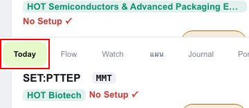 |
| 109 | Today · Daily | 390 | 6 | `button#tabBtnFlow` | Flow | chip font 11.22px < 13 (+24 more screens) | 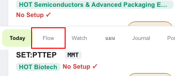 |
| 110 | Today · Daily | 390 | 6 | `button#tabBtnWatch` | Watch | chip font 11.22px < 13 (+24 more screens) | 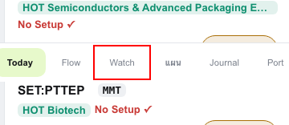 |
| 111 | Today · Daily | 390 | 6 | `button#tabBtnPlan` | แผน | chip font 11.22px < 13 (+24 more screens) | 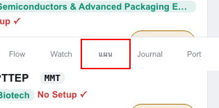 |
| 112 | Today · Daily | 390 | 6 | `button#tabBtnJournal` | Journal | chip font 11.22px < 13 (+24 more screens) | 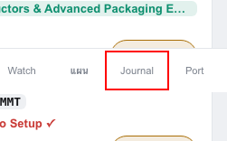 |
| 113 | Today · Daily | 390 | 6 | `button#tabBtnMix` | Port | chip font 11.22px < 13 (+24 more screens) | 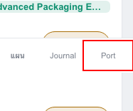 |
| 114 | Today · Daily | 390 | 6 | `div.tdWrap.td3 > div.card.ln4-card > div.r.ln4-l1 > span.ln4-room2` | room 5.0R | small font 12px < 13 (+2 more screens) | 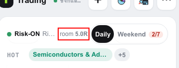 |
| 115 | Today · Daily | 390 | 6 | `div.card.ln4-card > div.r.ln4-l1 > span.ln4-room2 > b` | 5.0R | small font 12px < 13 (+2 more screens) | 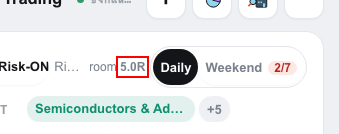 |
| 116 | Today · Daily | 390 | 6 | `div.r.ln4-l1 > span.sw > button > span.td3-bd` | 2/7 | chip font 12px < 13 (+1 more screens) |  |
| 117 | Today · Daily | 390 | 6 | `div.card.ln4-card > div.line.ln4-hot > span.r > button.pill.ln4-hc` | Semiconductors & Advanced Packaging Equi | tap target height 26px < 36 (+2 more screens) | 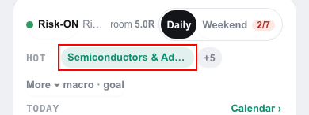 |
| 118 | Today · Daily | 390 | 6 | `div.card.ln4-card > div.line.ln4-hot > span.r > button.pill.p-n` | +5 | tap target height 26px < 36 (+2 more screens) | 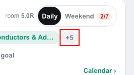 |
| 119 | Today · Daily | 390 | 6 | `div.tdWrap.td3 > div.card.ln4-card > div.line.ln4-today > button.rd` | Calendar › | tap target height 15px < 36 (+2 more screens) | 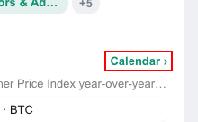 |
| 120 | Today · Daily | 390 | 6 | `div.card.ln4-card > div.line.ln4-today > div.ln4-evm > button.evl.past` | 11:00 China Consumer Price Index year-ov | tap target height 28px < 36 (+2 more screens) | 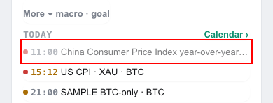 |
| 121 | Today · Daily | 390 | 6 | `div.card.ln4-card > div.line.ln4-today > div.ln4-evm > button.evl.soon` | 15:12 US CPI · XAU · BTC | tap target height 28px < 36 (+2 more screens) | 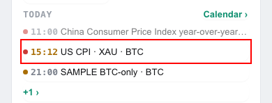 |
| 122 | Today · Daily | 390 | 6 | `div.card.ln4-card > div.line.ln4-today > div.ln4-evm > button.evl` | 21:00 SAMPLE BTC-only · BTC | tap target height 28px < 36 (+2 more screens) | 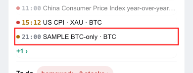 |
| 123 | Today · Daily | 390 | 6 | `div.card.ln4-card > div.line.ln4-today > div.ln4-evm > button.evl.more` | +1 › | tap target height 28px < 36 (+2 more screens) | 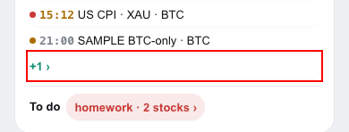 |
| 124 | Today · Daily | 390 | 6 | `div.tdWrap.td3 > div.card.ln4-card > div.todo.r > button.pill.p-r` | homework · 2 stocks › | tap target height 30px < 36 (+2 more screens) | 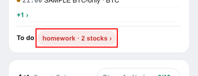 |
| 125 | Today · Daily | 390 | 6 | `div.td3-pn > div.card.ln4-card > div.it.ln4-row > span.sc.sat` | SAT | small font 12px < 13 (+5 more screens) |  |
| 126 | Today · Daily | 390 | 6 | `div#tabToday > div.tdWrap.td3 > details.ln4-more > summary` | Details · risk · sectors · accounts | small font 12.5px < 13 (+1 more screens) |  |
| 127 | Today · Weekend | 390 | 6 | `div.r.ln4-l1 > span.sw > button.on > span.td3-bd` | 2/7 | chip font 12px < 13 |  |
| 128 | Today · Weekend | 390 | 6 | `div.td3-wk > span.nm > span.td3-wtx > span.td3-new` | NEW | small font 9.5px < 13 (+2 more screens) |  |
| 129 | Watch · Candidates | 390 | 6 | `div#wlListBody > div.wlRows > div.tv1-gh.hot` | HOT · Semiconductors & Advanced Packagin | body font 13px < 14 |  |
| 130 | Watch · Watchlist | 390 | 6 | `div.panel.wlList > div.wlListHead > details.ln4w-sort > summary` | Sort · filter | small font 12.92px < 13 |  |
